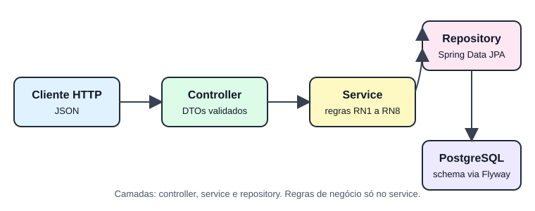
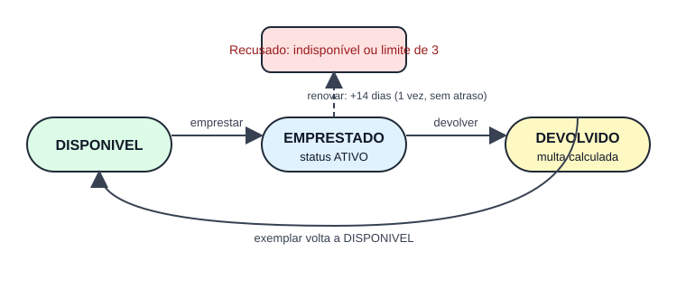

# biblioteca-emprestimos

[](https://github.com/famel-svg/biblioteca-emprestimos/actions/workflows/ci.yml)

API REST de empréstimos de livros em **Java 21 + Spring Boot 3.5**, com regras de negócio testadas, migrations Flyway, PostgreSQL, Docker e CI no GitHub Actions.

## Por que este projeto

- **Portfólio para vagas de Java júnior.** O objetivo é mostrar engenharia de testes e entrega (Testcontainers, Docker, CI verde), que aparecem nas vagas como diferencial. O domínio de empréstimo é o pretexto, não o foco.
- **Evitar cara de tutorial.** As regras de negócio foram escritas e documentadas pelo próprio autor, com decisões explícitas onde o enunciado era ambíguo ([docs/regras-de-negocio.md](docs/regras-de-negocio.md)).
- **Meta de qualidade explícita.** Cobertura de linhas de 80% ou mais, imposta pelo JaCoCo no `verify`. Hoje está em torno de 98%.

## Arquitetura



Controller recebe e valida o JSON, service aplica as regras, repository fala com o PostgreSQL. As migrations ficam em `src/main/resources/db/migration`, gerenciadas pelo Flyway. Detalhes em [docs/dominio.md](docs/dominio.md).

## Ciclo do empréstimo



## Regras de negócio

| # | Regra | Valor |
|---|---|---|
| RN1 | Não emprestar exemplar indisponível. | — |
| RN2 | Máximo de empréstimos ativos por usuário. | 3 |
| RN3 | Prazo padrão de devolução. | 14 dias |
| RN4 | Multa por dia de atraso (valor fictício). | R$ 2,00 |
| RN5 | Renovação, uma vez por empréstimo. | 1 |
| RN6 | Só renova se não estiver atrasado. | — |
| RN7 | Cada renovação soma o prazo à data prevista. | 14 dias |
| RN8 | Devolução fecha o empréstimo, calcula a multa e libera o exemplar. | — |

Detalhes e decisões sobre ambiguidades em [docs/regras-de-negocio.md](docs/regras-de-negocio.md).

## Como rodar

Com Docker (sobe PostgreSQL e a aplicação):

```bash
docker compose up --build
```

API em `http://localhost:8080`. Endpoints e exemplos em [docs/api.md](docs/api.md).

Para rodar os testes (precisa de Docker, por causa do Testcontainers):

```bash
./mvnw verify
```

No Windows, use `mvnw.cmd verify`. O relatório do JaCoCo fica em `target/site/jacoco/index.html`. Build e ferramentas em [docs/build.md](docs/build.md). Docker e CI em [docs/infraestrutura.md](docs/infraestrutura.md).

## Decisões

- **Java 21 e Spring Boot 3.5**, com Maven Wrapper, para build reproduzível sem instalar Maven.
- **Camadas controller, service e repository.** Regras só no service, controllers finos, entidades nunca expostas na API (DTOs em records).
- **Flyway em vez de `ddl-auto`.** O schema é versionado e a aplicação roda com `ddl-auto=validate`.
- **Clock injetado.** Regras de data são testadas sem depender do relógio real.
- **Testes em duas camadas.** Unitários com Mockito para cada regra, e integração com PostgreSQL real via Testcontainers para os endpoints.
- **Dados fictícios.** Nenhum dado pessoal real em exemplos, seeds ou testes.

## O que faria diferente

- Um ciclo de vida mais rico para o exemplar (em manutenção, perdido), em vez de só `DISPONIVEL` e `EMPRESTADO`.
- Reserva de exemplar, que hoje é recusado direto.
- Bloqueio de novos empréstimos para quem tem multa pendente. Ficou de fora do enunciado.
- Autenticação e perfis (bibliotecário e leitor). Hoje a API é aberta.
- Paginação nas listagens e um endpoint de histórico de empréstimos por usuário.
- Atualizar o Testcontainers para uma versão que negocie a API do Docker 29 e remover o `docker-java.properties`.

## Estrutura

```
src/main/java/br/com/famelsvg/biblioteca/
  controller/   endpoints REST
  service/      regras de negócio
  repository/   Spring Data JPA
  domain/       entidades e constantes das regras
  dto/          requests e responses validados
  exception/    erros de negócio e tratamento de erros
docs/           regras, arquitetura, API, build e infraestrutura
```

## Licença

Uso de portfólio. Dados de exemplo fictícios.
